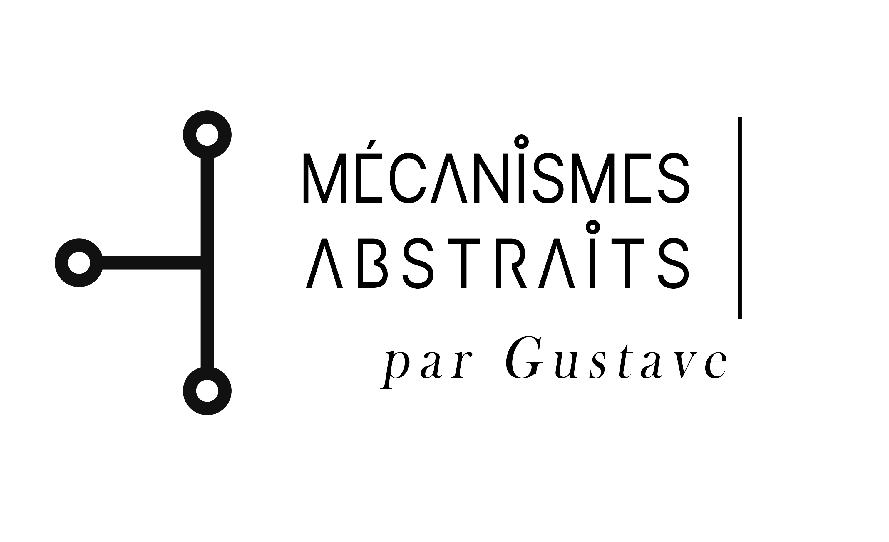

  

<h1 align="center">Gustave · Abstract Mechanisms</h1>

  Software systems · language engineering · experimental RISC-V development · AI-orchestrated research

I develop independent software and research projects with an emphasis on reproducible workflows, technical documentation, source provenance, and explicit boundaries between demonstrated results and open questions.

## AI-orchestrated research and RISC-V systems

- **[AI-Orchestrated Experimental Development](https://github.com/MA-Gustave/AI-Orchestrated-Experimental-Development)**  
  An evolving research manuscript and public methodology for AI-assisted software experimentation: hypotheses, implementation candidates, correctness checks, measurements, evidence, and revision. **Working research, not peer reviewed.**

- **[RVV-VLA Lab](https://github.com/MA-Gustave/RVV-VLA-Lab)**  
  Experimental RISC-V Vector Extension (RVV), vector-length-agnostic parsing systems, test orchestration, benchmark protocols, and recorded research evidence. Results are specific to the documented source, workloads, toolchains, and hardware—not universal speedup claims.

- **[simdjson-rvv-vla](https://github.com/MA-Gustave/Simdjson-rvv-vla/tree/feature/rvv-vla-v5)**  
  An **independent experimental fork** extending the original [simdjson](https://github.com/simdjson/simdjson) software with RVV-VLA development and integration. The v5.0.3 migration identifies native RVV correctness verification still to be completed; see its [migration status](https://github.com/MA-Gustave/Simdjson-rvv-vla/blob/feature/rvv-vla-v5/RVV_V5_MIGRATION_STATUS.md).

## Language engineering systems

- **[GF RGL AI Compendium](https://github.com/MA-Gustave/GF_RGL_AI_Compendium)**  
  Structured knowledge, provenance, contracts, and workflows for Grammatical Framework and RGL language engineering.

- **[GF Wordbench](https://github.com/MA-Gustave/GF_Wordbench)**  
  Validation, diagnostics, regression testing, and preserved evidence for active GF language projects.

- **[GF Observatory](https://github.com/MA-Gustave/GF_Observatory)**  
  Historical views of project maturity, readiness, and health from versioned evidence.

- **[Ars Magna Lulli](https://github.com/MA-Gustave/Ars-Magna-Lulli)**  
  A monorepo connecting the Compendium, Wordbench, and Observatory.

## Attribution and independence

The original **simdjson** project, its authors, contributors, licences, and publications remain distinct from my experimental RVV-VLA work. My fork is **not** an official simdjson release and does **not** imply upstream endorsement, acceptance, or validation. I am not submitting this experimental work for upstream review or asking the original maintainers to validate, debug, repair, integrate, or maintain it.

My research process is described in [AI-Orchestrated Experimental Development](https://github.com/MA-Gustave/AI-Orchestrated-Experimental-Development). Its published evidence and limitations should be consulted before interpreting technical or performance claims. See the fork's [scope and provenance statement](https://github.com/MA-Gustave/Simdjson-rvv-vla/blob/feature/rvv-vla-v5/FORK_SCOPE.md) for responsibility and attribution boundaries.

  Project-specific documentation, licensing, validation status, and technical evidence are maintained in the respective repositories.

