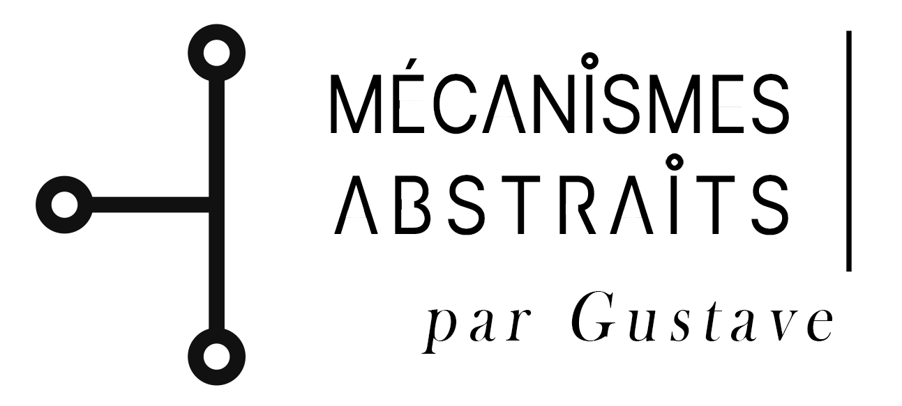

  

 <em>Des idées rendues opératoires. · Ideas made operational.</em>

**I build software where language, rules, AI-assisted implementation and rigorous verification meet.** My primary work is in computational linguistics with Grammatical Framework (GF) and its Resource Grammar Library (RGL). I also investigate what becomes possible when human-directed AI helps implement complex software systems.

### [Explore the website ↗](https://ma-gustave.github.io/MA-Gustave/)

**[Français ↗](https://ma-gustave.github.io/MA-Gustave/fr/)** · [Language engineering ↗](https://ma-gustave.github.io/MA-Gustave/linguistics.html) · [AI development thesis ↗](https://ma-gustave.github.io/MA-Gustave/ai-development.html) · [Native benchmark evidence ↗](https://ma-gustave.github.io/MA-Gustave/rvv-results.html)

*The website is a static GitHub Pages site hosted from `docs/` in this profile repository. The links become active after GitHub Pages has been enabled for `main` → `/docs`.*

---

### Language engineering

**[GF Wordbench](https://github.com/MA-Gustave/GF_Wordbench)** is an implemented validation and diagnostics workbench with source code, tests and CI infrastructure. The **Albanian (sqi) GF/RGL** effort includes a substantial grammar and morphology source base with advanced verification tooling, while exact-source native compilation and expert linguistic certification remain separate release gates.

**[GF RGL AI Compendium](https://github.com/MA-Gustave/GF_RGL_AI_Compendium)** provides an independent, source-grounded engineering reference. **[Ars Magna Lulli](https://github.com/MA-Gustave/Ars-Magna-Lulli)** and **[GF Observatory](https://github.com/MA-Gustave/GF_Observatory)** document the proposed multi-language aggregation and publication architecture.

### An argument for AI-directed development

**[AI-Orchestrated Experimental Development](https://github.com/MA-Gustave/AI-Orchestrated-Experimental-Development)** is a working research manuscript proposing a shift from hand-authoring each code line toward specifying systems, directing implementation, and validating evidence. This is a position paper, not an independently confirmed causal productivity study.

### Systems engineering, measured natively

**[VectorPath-RVV](https://github.com/MA-Gustave/VectorPath-RVV)** and **[VLA-MethodLab](https://github.com/MA-Gustave/VLA-MethodLab)** report Test 106 native DOM throughput of **1.6007× on Cloud-V** and **1.8946× on EPCC**, versus **official simdjson 5.0.4 fallback** on **18 pinned public JSON documents** (paired geometric means). These are specific baseline and corpus comparisons, not universal speedups. [Read the Test 106 report.](https://github.com/MA-Gustave/VectorPath-RVV/blob/main/docs/release/TEST106_PUBLICATION_REPORT_EN.md)

**Observe → Represent → Build → Verify → Document.**

*© 2026 Mécanismes Abstraits · Gustave. The language projects, research hypotheses and native performance results are described with explicit evidence boundaries on the website.*
