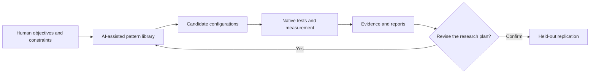

# AI-Orchestrated Experimental Development

**Beyond writing code: automation, higher-level abstraction, and experimentally grounded software development.**

**A research manuscript and open documentation project by Gustave · Abstract Mechanisms.**  
**Status:** working manuscript / public research notes · **13 October 2026** · **not peer reviewed**.

> **Central proposition.** When technical operations become sufficiently reliable and automated, human work can shift toward the design, coordination and assessment of higher-level systems. Generative AI may extend this shift from compilation and model transformation to implementation, experiment construction and evidence analysis. This does *not* mean that code, programmers, or low-level expertise have become unnecessary.

The central contribution is **not a record JSON parsing speedup**. This repository examines a method for directing low-level technical research through AI-assisted implementation, an extensible library of optimization patterns, experimental campaigns, retained negative results, and iterative reports. [VLA-MethodLab](https://github.com/MA-Gustave/VLA-MethodLab) provides the experimental case study, while [VectorPath-RVV](https://github.com/MA-Gustave/VectorPath-RVV) is the resulting RVV-VLA engine. Neither is the identity of this manuscript repository.

## Start reading

| Resource | What it covers |
| --- | --- |
| **[Full research manuscript](manuscript/ARTICLE_EN.md)** | Main argument, literature, case study, hypotheses, limitations |
| [Abstract](manuscript/ABSTRACT_EN.md) | Concise overview for readers and prospective reviewers |
| [Research thesis and scope](docs/THESIS_AND_SCOPE.md) | What is proposed, observed, and not demonstrated |
| [Conceptual framework](docs/CONCEPTUAL_FRAMEWORK.md) | Aristotle, Simon, Licklider, Engelbart, automation |
| [Public research method](docs/PUBLIC_METHOD.md) | Patterns → candidate plans → experiments → reports → revision |
| [RVV-VLA case study](docs/RVV_VLA_CASE_STUDY.md) | Primary results, provenance and limitations |
| [Evidence ledger](docs/EVIDENCE_LEDGER.md) | Claims, source links, evidence category and caveats |
| [JSON workload metadata hypothesis](docs/JSON_METADATA_HYPOTHESIS.md) | Optional hints for workload-aware engine choice |
| [Research questions](docs/RESEARCH_QUESTIONS.md) | Falsifiable hypotheses and evaluation plans |
| [Annotated references](references/REFERENCES.md) / [BibTeX](references/references.bib) | Academic foundations and related work |
| [GitHub Wiki](https://github.com/MA-Gustave/AI-Orchestrated-Experimental-Development/wiki) / [Wiki source](wiki/Home.md) / [Publishing instructions](docs/WIKI_PUBLISHING.md) | English research wiki with compact Abstract Mechanisms logo |
| [Publication checklist](docs/PRE_PUBLICATION_CHECKLIST.md) | Checks before a DOI, preprint or conference submission |
| **[Publish at MA-Gustave on GitHub](docs/PUBLISH_TO_GITHUB.md)** | GitHub CLI / Git instructions, separate Wiki deployment |

## Working model

The current RVV-VLA E00–E14 set consists of **15 fixed experimental configurations**. It is *not* an autonomous, continuously self-tuning search system. Hypothesis generation and reporting can involve AI; benchmark validity remains a matter of tests, source provenance and human accountability.

## Primary repositories and dataset provenance

- **[VLA-MethodLab](https://github.com/MA-Gustave/VLA-MethodLab)** — the experimental method and testing framework: pattern library, candidate configurations, orchestration, measurements, validation scripts and research evidence.
- **[VectorPath-RVV](https://github.com/MA-Gustave/VectorPath-RVV)** — the optimized RISC-V Vector (RVV-VLA) JSON engine and implementation developed and evaluated through the laboratory, based on simdjson. See its [technical overview](https://github.com/MA-Gustave/VectorPath-RVV/blob/main/README.md) and [performance notes](https://github.com/MA-Gustave/VectorPath-RVV/blob/main/PERFORMANCE.md).
- [15 E00–E14 candidate plans](https://github.com/MA-Gustave/VLA-MethodLab/blob/main/experiments/PATTERN_LIBRARY.md) — experimental design in VLA-MethodLab.
- [Stage 1 / Stage 2 / DOM study](https://github.com/MA-Gustave/VLA-MethodLab/blob/main/docs/results/2026-10-11-stage-profile-8h.md) — archived measurements and limitations.
- [Measurement methodology](https://github.com/MA-Gustave/VLA-MethodLab/blob/main/docs/METHODOLOGY.md) — testing and evidence standards.

**Reported, not independently replicated here:** the 11 October 2026 native campaign reports 6,887 measurements and paired geometric-mean ratios for E14 versus official VLS256 of **1.502× DOM**, **1.601× Stage 1**, **1.298× Stage 2**. A substantial Stage 1 regression is also documented for heavily escaped strings. These are workload- and machine-specific values, not universal improvements. The study predates the separation into VLA-MethodLab and VectorPath-RVV; their current repository heads should not be assumed to reproduce the exact measured working tree. The historical source was a modified working tree: the upstream commit SHA alone cannot reconstruct the precise measured code. See the [evidence ledger](docs/EVIDENCE_LEDGER.md).

## Four different claim types

- **Documented observation:** a claim traceable to project data, version identifiers or primary sources; not necessarily independently replicated.
- **Conceptual interpretation:** a philosophical comparison, not empirical proof.
- **Publicly described method:** the parts of the workflow disclosed in sufficient detail to interpret the case study.
- **Research hypothesis:** a proposed mechanism requiring a prospective test, such as out-of-band workload metadata for JSON parsing.

This repository does not claim priority for algorithm selection, program synthesis, autotuning, or hierarchical theories of complexity. Relevant prior work is cited explicitly.

## Why a separate repository?

A scientific argument requires a stable place for its text, references, corrections and review history. [VLA-MethodLab](https://github.com/MA-Gustave/VLA-MethodLab) contains the experimental methodology and evidence; [VectorPath-RVV](https://github.com/MA-Gustave/VectorPath-RVV) contains the implementation studied. This repository is the *interpretation and publication layer*: a research article, its methods, and its bibliographic trail.

## Author identity, confidentiality and citation

**Public project attribution:** Gustave, under the *Abstract Mechanisms* research identity. Formal publication names, potential coauthors, ORCID, DOI and licensing of the original written material require deliberate confirmation. [Citation template](CITATION.cff.example) is not an assertion of a legal name or DOI. Keep original simdjson copyright and licence notices intact and distinguish upstream work from RVV-VLA changes.

Internal prompts and private orchestration procedures are **not included**. This is compatible with a public conceptual paper only insofar as claims that demand reproducibility rely on disclosed experiments, measurements and code; no hidden process is offered as uncheckable evidence of superiority. See [Research integrity](docs/ATTRIBUTION_AND_PRIVACY.md).

## Wiki and publication status

The `wiki/` directory contains actual English wiki pages and serves as their auditable mirror. **GitHub does not turn this directory into the live Wiki automatically.** Once the main repository exists and its Wiki is initialized, publish the supplied pages using [the wiki instructions](docs/WIKI_PUBLISHING.md) and [PowerShell publishing script](scripts/publish-wiki.ps1). Repository: **[MA-Gustave/AI-Orchestrated-Experimental-Development](https://github.com/MA-Gustave/AI-Orchestrated-Experimental-Development)**. The GitHub Wiki is maintained separately at the corresponding `/wiki` URL.

ABSTRACT MECHANISMS · by Gustave · Ideas made operational.

